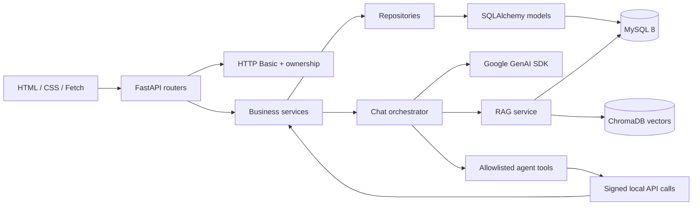

# AI Smart Food Ordering & Restaurant Assistant

A fictional food-ordering app with a browser interface and a Google Gemini assistant. MySQL is the documented target database; SQLite is reserved for isolated local smoke tests.

## Delivery checklist

- [x] 1. Setup/configuration, app startup, health endpoint
- [x] 2. ORM schema, MySQL/Alembic migrations, seed fixtures
- [x] 3. Catalog and order APIs, services, repositories, domain constraints
- [x] 4. HTTP Basic auth, role/owner checks, error mapping
- [x] 5. Manual browser workflow: catalog, order, status, admin screens
- [x] 6. Persistent chat sessions/messages and general Gemini chat
- [x] 7. Document upload, parsing, chunking, embedding, retrieval, citations
- [x] 8. Single agent, allowlisted API tools, persisted confirmation gate, idempotency
- [x] 9. Mixed orchestration and polished UI integration
- [x] 10. Documentation, architecture/use-case diagrams, setup and demo steps

## Setup

Requires Python 3.11+ and MySQL 8 for the target acceptance path. Copy `.env.example` to `.env`, set a private `DATABASE_URL` and `GEMINI_API_KEY`, then install with `pip install -e '.[test]'`. Apply schema and seed fictional data with `alembic upgrade head` and `python -m app.seed`. Start the API with `uvicorn app.main:app --reload`; OpenAPI is available at `/docs` and health at `/health`.

Demo accounts use HTTP Basic credentials: `asha@example.test`, `rohan@example.test`, and `admin@example.test`; their local seed password is `FoodDemo123!` unless `DEMO_PASSWORD` is set before seeding. Change the demo password before exposing a non-local environment. Never commit `.env`.

Catalog reads are public and accept `category`, `vegetarian`, `max_price`, and `keyword`. Order writes require HTTP Basic and an `Idempotency-Key` header. Admin catalog and status routes require the seeded admin role. Order IDs not owned by the caller are concealed as 404. Errors use `{ "code", "message", "request_id" }`.

New customers can create an account at `/register` or `POST /api/auth/register`. Registration always assigns the `USER` role, normalizes email addresses, and stores an Argon2 password hash. Signing out clears the in-memory HTTP Basic credentials; the dashboard never saves credentials to browser storage.

Policy examples are in `docs/policies/`. An admin can upload them at `POST /api/documents` as multipart field `upload`; successful uploads are versioned, chunked, embedded with `GEMINI_EMBEDDING_MODEL`, and indexed in the configured Chroma directory. Policy answers cite the active filename and page/section, or state that evidence cannot be verified.

## MySQL Setup

Create a dedicated database and least-privilege application account in MySQL 8:

```sql
CREATE DATABASE smart_food CHARACTER SET utf8mb4 COLLATE utf8mb4_0900_ai_ci;
CREATE USER 'food_app'@'localhost' IDENTIFIED BY 'set-a-private-password';
GRANT SELECT, INSERT, UPDATE, DELETE, CREATE, ALTER, INDEX, REFERENCES ON smart_food.* TO 'food_app'@'localhost';
```

Put the resulting private URL in `.env` as `DATABASE_URL=mysql+pymysql://food_app:<password>@127.0.0.1:3306/smart_food`, configure `GEMINI_API_KEY`, then run `alembic upgrade head` and `python -m app.seed`. Do not use the example password on a shared machine. Run the server with `uvicorn app.main:app --reload`; it serves the static frontend at `/`, OpenAPI at `/docs`, and health at `/health`. Terminate TLS outside localhost.

The default text model is `gemini-3.8-flash` (stable on Google's model catalog when this capstone was prepared); embeddings use `gemini-embedding-001`. Both are configurable. Gemini 2.5 Flash is deprecated, so do not restore it as the default. See [Google's model catalog](https://aistudio.google.com/docs/models).

## Architecture



Routers validate requests and enforce identity; services own business rules and transaction boundaries; repositories own queries. Browser, agent, and public APIs use the same order/catalog services. MySQL remains authoritative for prices, stock, status, active document versions, and all persisted chat/action state. The agent can only read live data or create a persisted proposal; the confirm/reject endpoints are the only path that completes a proposed write.

## Use Cases

```mermaid
sequenceDiagram
	actor Customer
	participant UI as Browser / Chat
	participant API as FastAPI + Services
	participant DB as MySQL
	participant AI as Gemini / RAG
	Customer->>UI: Search menu / ask question
	UI->>API: GET menu or POST chat message
	API->>DB: Save user turn before model processing
	API->>AI: General, evidence retrieval, or allowlisted tool call
	AI->>API: Answer, cited evidence, or proposal request
	API->>DB: Persist answer, citations, tool runs, pending action
	API-->>UI: Saved response and optional proposal terms
	Customer->>UI: Explicitly confirm or reject proposal
	UI->>API: POST action decision + idempotency key
	API->>DB: Recheck owner, state, stock, and price; commit once
	API-->>UI: Actual service outcome
```

## Demo Walkthrough

1. Sign in as `asha@example.test` / `FoodDemo123!`; browse the public menu, filter by vegetarian/category/price, add Masala Dosa, and place the order. The server response is the source of truth for the receipt and remaining portions.
2. Use the recent order list to request cancellation while it is `PLACED` or `ACCEPTED`. Repeated requests use an idempotency key; after preparation begins the API refuses cancellation.
3. Sign in as `admin@example.test` / `FoodDemo123!`; edit or soft-disable a menu entry and use the order desk to make only the next permitted status transition.
4. Upload `docs/policies/allergen-and-ingredients.txt` and `docs/policies/order-and-cancellation.txt` through the admin upload endpoint. Ask the assistant about declared allergens; it cites the active filename and section. It never guarantees allergen safety.
5. Ask a general question, then ask for live menu/availability facts. With `GEMINI_API_KEY` configured, the assistant uses Gemini; order/cancellation proposals show exact server-calculated terms and require an explicit Confirm or Reject. Without the key, safe persisted outage responses are shown.
6. Refresh or restart the app and reopen the saved chat to see ordered history and any still-pending proposal loaded from MySQL.

Demo accounts are fictional and use the local seed password `FoodDemo123!` unless `DEMO_PASSWORD` is set before seeding. Change it before exposing a non-local environment.

## Tests

Run the local API/service suite with `pytest`. AI provider calls, vector retrieval, and function-call outputs are mocked in tests. For row-lock/oversell verification, create a **separate disposable MySQL test database**, migrate it, and opt into the MySQL-only concurrency test:

```bash
export MYSQL_TEST_DATABASE_URL='mysql+pymysql://food_test:<private-password>@127.0.0.1:3306/smart_food_test'
DATABASE_URL="$MYSQL_TEST_DATABASE_URL" alembic upgrade head
pytest tests/test_mysql_concurrency.py
```

The MySQL test creates and removes uniquely named fixtures; it never targets the demo database unless explicitly configured. A live Gemini smoke test is intentionally opt-in: configure a private `GEMINI_API_KEY` and verify general chat, cited policy retrieval, and proposal confirmation manually.
